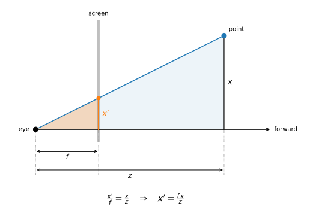

# The 3D camera

This document explains how a 3D camera turns positions in space into pixels on the screen, and pixels back into positions so a click can land somewhere, the problems that shaped EMMA's camera, and how I built it. Everything the camera does comes down to two directions:

```
point → pixel   (projection)   to draw anything
pixel → point   (picking)      to know what the mouse is over
```

Most of the code is in `app/Camera.hpp`.

## 1. The camera: what it is and why we need it

### An orbit camera

EMMA's camera circles a point you're looking at, the target. Right-drag turns the view around it, Shift+right-drag or middle-drag pans, scrolling zooms toward the cursor, and T looks straight down. Follow keeps a body in the middle, and a faint grid shows the plane new bodies are placed on.

The simulation runs in three dimensions, but a screen has two. A camera is what decides how one becomes the other: where you look from, which way, and how wide.

The whole camera is four numbers:

- the target, the point it circles and looks at, in AU;
- the distance from the eye to the target, in AU;
- the yaw, how far it has turned around the ecliptic's pole;
- the pitch, how high above the ecliptic plane it sits: 90° looks straight down.

The eye itself isn't stored. It follows from those four: start at the target and step back by the distance along the viewing direction.

### The camera's three directions

To draw anything, the camera needs its own three directions, written in the same coordinates as the bodies:

- right, across the screen from left to right;
- up, up the screen;
- forward, into the screen, the way the camera looks.

All three come from the yaw and the pitch. In the top view, yaw 0° and pitch 90°, right is the world's +x, up is +y, and forward points straight down. Lowering the pitch tilts forward away from straight down, toward the horizon; at 0° you look along the ecliptic plane, edge-on. Changing the yaw spins all three around the vertical axis.

The three are always one unit long and at right angles to each other (orthonormal), with up = right × forward.

### From a point to a pixel

The first step measures a point against the camera. Take the arrow from the eye to the point, and see how far it reaches along each of the camera's three directions. The result is the point in camera coordinates: how far right, how far up, and how far ahead of the eye, its depth.

How far an arrow reaches along a direction one unit long is their dot product. So the step is three dot products, the same as multiplying by a rotation whose rows are the three directions. It's the same idea as the ecliptic to Galactic rotation in `galaxy-view.md`.

The second step is perspective, and it comes straight from similar triangles. Imagine the screen as a window a distance f in front of your eye. A point at depth z and a distance x to the right is seen through the window at:



The farther away the point, the bigger z and the smaller x', so things shrink toward the middle of the screen. That's all perspective is. Without the division by z, everything keeps its size whatever its depth: that's an orthographic camera.

### Field of view and focal length

The field of view is how wide an angle the screen covers from top to bottom. EMMA uses 45°, a natural lens that isn't too wide. The focal length f is how far the window must be from the eye, in pixels, for half the view's height to cover half that angle:

```
tan(22.5°) = (height / 2) / f      so      f = (height / 2) / tan(22.5°)
```

tan(22.5°) is exactly √2 − 1, 0.41421356...

At depth z, one AU sideways covers f / z pixels. At the target that sets the status bar's "View ... across", and at each body's own depth it sets the body's size.

### Things behind the eye

Dividing by z only works when z is positive. A point behind the eye has a negative z, and dividing by it flips the point to the other side of the screen. A z near zero sends it off toward infinity. So a camera has a near plane, a depth just in front of the eye, and doesn't draw anything closer.

A line from in front of the eye to behind it has to be cut where it crosses the near plane. Moving from one end to the other, the depth changes at a steady rate, so the fraction of the way along at which it reaches the near plane is a simple ratio. Replacing the end behind the eye with that crossing point leaves only the visible part. This is linear interpolation, and cutting a shape down to what can be drawn is called clipping. Graphics cards do the same for every triangle they draw.

### From a pixel to a point

Projection squeezes 3D onto 2D, so one pixel covers a whole line of points: everything along a ray from the eye through that pixel. To turn a click into one point, you find where that ray meets a flat plane. This is ray casting, or picking.

The ray is the projection run backward: one step forward, then the pixel's offset from the middle of the view, divided by f, to the right and up. Points along the ray are the eye plus some multiple t of it. Setting their height equal to the plane's height and solving for t takes one division. That's the ray-plane intersection.

### The painter's algorithm

In 3D, what matters when two bodies overlap on screen is which one is in front. The simplest answer is to draw from farthest to nearest, so nearer things cover farther ones. That's the painter's algorithm: paint the background first and the foreground over it.

## 2. Problems and decisions

### Which kind of camera

Problem: EMMA started with a flat camera that only looked straight down. A 3D camera can be free-flying, moving and looking anywhere as in many games, but it's easy to get lost in empty space with one.

Decision: an orbit camera. In a simulator you're always studying something: a planet, a pair of stars, the whole system. An orbit camera always keeps that thing in the middle. Turning swings you around it, and zooming moves you toward or away from it. Its top view is exactly the old flat view, so EMMA still starts out looking the way it always did.

### Looking straight down

Problem: the common way to build a camera's directions, look at the target and keep the world's up as up, breaks at exactly the view EMMA starts in. Looking straight down, the world's up and the viewing direction are parallel, their cross product is zero, and right is undefined. That's the gimbal problem.

Decision: build the three directions from the yaw and the pitch, which never needs that cross product, so 90° works like any other angle.

### Perspective or orthographic

Problem: an orthographic camera is simpler, but a tilted orbit then looks the same whether it tilts toward you or away.

Decision: perspective, which gives the eye a depth cue. In the top view the planets all sit at nearly the same depth, so the picture still looks flat there.

### Zooming in close, far from the origin

Problem: a float keeps about 7 digits. The Earth and Moon are 0.0026 AU apart, 1 AU from the origin; in floats, positions that close round to the same value and the picture shakes.

Decision: subtract the target from every point first, in double precision, before anything turns into pixels. Only small numbers near the target reach the graphics card. `big-scale-view.md` shows how far out this holds.

### A near plane that fits every zoom

Problem: the zoom runs from 15 km to 48 kpc. A fixed near plane would be far too close at one end and far too far at the other.

Decision: the near plane is a fixed fraction of the distance, 10⁻⁴: 0.001 AU when you look from 10 AU away, 1.5 km when you look from 10⁻⁴ AU, close to the Moon. A single point behind it is skipped, and a line crossing it is clipped.

### The stars

Problem: background stars are so far away that moving the camera never changes where they appear; only turning does. Treating them as points would mean huge numbers for no reason.

Decision: a star is stored as a direction, and its place on screen uses only the turning part, the three dot products, with no eye position. Stars more than 60° from the middle of the view are skipped: they're off-screen anyway, and nearly sideways ones would land on huge pixel numbers.

### Which plane a click lands on

Problem: a pixel covers a whole ray, so a click needs a plane to land on, and that plane has to make sense to the person clicking.

Decision: the grid, the plane parallel to the ecliptic through the target. While you follow a body, the grid passes through it, so new bodies start level with it. The grid is drawn on exactly this plane, so what you see is where a click lands.

### Clicks near the horizon

Problem: just under the horizon, the ray meets the grid absurdly far away, and a click there would place a body thousands of AU off.

Decision: a pick fails when the ray meets the plane more than 1,000 times the viewing distance away, when it runs parallel to the plane, or when the plane is behind the eye.

### Launch direction in a tilted view

Problem: in a tilted view, a drag's direction on screen isn't its direction in space.

Decision: pick both ends of the drag on the grid, and use the direction between those two points. If the far end misses the grid, use the angle on screen plus the camera's yaw, which is exact in the top view and close in others. The launch arrow works the other way round: EMMA projects the start and a tiny step along the velocity, and points the arrow between those two pixels, 4 pixels per km/s.

### Turning

Problem: dragging should feel the same at every zoom, and spinning past the pole would flip the view upside down.

Decision: each pixel of right-drag turns the view by 0.005 radians, about 0.29°, whatever the zoom. The pitch stops at straight down and straight up, and the yaw wraps around so it stays between −180° and 180°.

### Panning in a tilted view

Problem: panning should feel like dragging a map, at any view angle.

Decision: grab the grid. Find the grid point under the mouse before it moved and the one under it now, and move the camera by the difference. The point that was under the mouse ends up under it again. Near the horizon a few pixels can cover thousands of AU of grid, so when one mouse move would jump more than twice the viewing distance, panning slides by a fixed amount per pixel instead, keeping the target at the same height.

### Zooming across a huge range

Problem: adding a fixed step to the distance would feel sluggish at 30 AU and wild at 0.001 AU.

Decision: zoom multiplies the distance by a factor, an exponential zoom, so it feels the same everywhere. A wheel notch adds to a zoom speed that dies away over a few frames, and one notch ends up roughly halving the distance. Zooming toward the cursor keeps the grid point under the cursor fixed: note that point, change the distance, see where that pixel lands now, and slide the camera by the difference.

### Zooming in on a planet

Problem: zooming toward the cursor aims at the grid point under it. A planet usually sits above or below the grid, and in the galaxy view everything also moves at 247 km/s, so scrolling at a planet that way would fly past it into empty space.

Decision: a body under the cursor takes over.

- Scrolling in over a body follows it, and the zoom then heads straight for it.
- Double-clicking a body follows it: two clicks within 0.4 s and 8 px of each other.
- A single click on a body doesn't place a new body on top of it, and the preview doesn't show while the cursor is over one. Dragging from a body still launches a new one.
- The view glides to a body you start following, over 0.4 s, easing in and out. The body keeps moving during the glide, so the glide aims at where it is in each frame.
- While following a body, the eye stays at least 1.15 of its radii from its center, so zooming in stops just outside the surface. For a black hole it stops at 3 Schwarzschild radii.

A body counts as under the cursor within its drawn radius, at least 6 px. Black holes are picked by their marker or shadow, at least 8 px.

### Following a body

Problem: bodies sit in a list, and a merge removes one and shifts every body after it, so a place in the list doesn't stay attached to a body.

Decision: follow bodies by name. Every frame, after the physics step, the target moves to the named body. Panning stops following, since panning means "look somewhere else". F, Fit view, puts the target at the system's center of mass and fits it into the short side of the view, and stops following too, except in the galaxy view.

### Moons inside planets

Problem: zoomed out, a moon sits inside its planet's marker, and drawing both looks like one smudge. Clicking there could pick the hidden moon.

Decision: check bodies heaviest first, and hide a body while its center sits inside the marker of one of the 32 heaviest bodies before it. That keeps the Moon out of Earth's dot until you zoom in far enough to separate them. Picking uses the same rule, so a double-click on Earth picks Earth.

### A grid that reads well at every zoom

Problem: fixed grid spacing would be a solid mesh zoomed out and invisible zoomed in.

Decision: the spacing is about a fifth of the viewing distance, rounded up to a tidy number such as 0.01, 0.02, 0.05 or 0.1 AU, so the lines land on readable values. 41 lines run each way, centered on the target. Each line is drawn as short segments so each point can have its own transparency, and the grid fades out toward its edges instead of ending in a hard square. `spacetime-grid.md` explains how the grid can bend.

## 3. How I built it

### The axes

```cpp
void aim() {
    const double cy = std::cos(yawAngle), sy = std::sin(yawAngle);
    const double cp = std::cos(pitchAngle), sp = std::sin(pitchAngle);
    right = emma::Vector3D(cy, sy, 0.0);
    up = emma::Vector3D(-sy * sp, cy * sp, cp);
    forward = emma::Vector3D(-sy * cp, cy * cp, -sp);
}
```

Put in yaw 0° and pitch 90°, cos 90° = 0 and sin 90° = 1, and you get right = (1, 0, 0), up = (0, 1, 0), forward = (0, 0, −1): the top view.

`aim()` only runs when the view turns, through `orbit` and `setAngles`. Drawing then sends thousands of trail points through the same three axes each frame, so I keep them instead of working them out from sines and cosines every time. That's also why `Camera` is a class with yaw and pitch private: they can only change through functions that call `aim()`.

### Projection

```cpp
emma::Vector3D toCamera(const emma::Vector3D& w) const {
    const emma::Vector3D d = (w - target) + forward * distance;
    return emma::Vector3D(d.dot(right), d.dot(up), d.dot(forward));
}

sf::Vector2f project(const emma::Vector3D& c) const {
    const sf::Vector2f m = middle();
    const double s = focal() / c.z;
    return sf::Vector2f(static_cast<float>(m.x + c.x * s), static_cast<float>(m.y - c.y * s));
}
```

The eye sits at `target − forward · distance`, so `(w − target) + forward · distance` is the arrow from the eye to the point. In `project`, `m.x +` moves the result to the middle of the view, since pixels count from the top-left corner, and `m.y −` flips y, because pixel y grows downward.

```cpp
static constexpr double TAN_HALF_FOV = 0.41421356237309515;  // a 45 degree field of view
double focal() const { return 0.5 * viewport.size.y / TAN_HALF_FOV; }  // pixels
double pxPerAU() const { return focal() / distance; }                  // at the target
```

`toScreen` does both steps and returns `std::optional<sf::Vector2f>`, empty when the point is behind the near plane, so callers have to check.

### The stars

```cpp
std::optional<sf::Vector2f> toScreenDirection(const emma::Vector3D& d) const {
    const emma::Vector3D c(d.dot(right), d.dot(up), d.dot(forward));
    if (c.z <= 0.5) return std::nullopt;
    return project(c);
}
```

`c.z` is the cosine of the angle from the middle of the view, and cos 60° = 0.5.

### Clipping

```cpp
bool clip(emma::Vector3D& a, emma::Vector3D& b) const {
    const double near = NEAR * distance;
    if (a.z <= near && b.z <= near) return false;
    if (a.z < near) a = a + (b - a) * ((near - a.z) / (b.z - a.z));
    else if (b.z < near) b = b + (a - b) * ((near - b.z) / (a.z - b.z));
    return true;
}
```

Every line EMMA draws, trails, the dashed preview, the grid and the galaxy view's heading arrow, goes through one function in the renderer, so clipping happens in one place:

```cpp
void Renderer::addSegment(const Camera& camera, Vector3D a, Vector3D b, sf::Color ca, sf::Color cb) {
    if (!camera.clip(a, b)) return;
    lines.append(sf::Vertex{camera.project(a), ca});
    lines.append(sf::Vertex{camera.project(b), cb});
}
```

### Picking

```cpp
std::optional<emma::Vector3D> pick(sf::Vector2f s, double planeZ) const {
    const sf::Vector2f m = middle();
    const double f = focal();
    const emma::Vector3D ray = forward + right * ((s.x - m.x) / f) - up * ((s.y - m.y) / f);
    const emma::Vector3D eye = forward * -distance;  // relative to the target
    if (ray.z == 0.0) return std::nullopt;
    const double t = (planeZ - target.z - eye.z) / ray.z;
    if (t <= 0.0 || t > MAX_PICK * distance) return std::nullopt;
    return target + (eye + ray * t);
}
```

`pick(s)` calls it with `planeZ = target.z`, the grid. Placing a body, the launch direction, zooming toward the cursor, panning and the status bar's "Cursor x, y" all use it.

### Zoom and pan

```cpp
void zoomAt(sf::Vector2f screenPoint, double factor) {
    const std::optional<emma::Vector3D> before = pick(screenPoint);
    zoom(factor);
    const std::optional<emma::Vector3D> after = pick(screenPoint);
    if (before && after && (*before - target).magnitude() < 20.0 * distance) target += *before - *after;
}
```

`zoom` divides the distance by the factor and clamps it between `MIN_DISTANCE` and `MAX_DISTANCE`. `main.cpp` keeps a zoom speed: each wheel notch adds to it, it shrinks by 15% a frame, and each frame divides the distance by (1 / 0.9) raised to that speed.

`pan` picks the grid point under both mouse positions and moves the target by the difference, unless that would jump more than twice the distance. Then it moves `distance / focal()` AU per pixel along `right` and a level "ahead" direction.

### The glide

```cpp
const double k = std::min(1.0, static_cast<double>(glideTime / GLIDE_SECONDS));
camera.target = *glideFrom + (p - *glideFrom) * (k * k * (3.0 - 2.0 * k));
```

k²(3 − 2k) is smoothstep: it starts and ends with zero speed. `p` is the body's position in the current frame.

### Bodies

`Renderer::drawBodies` works in three passes:

1. Project every body, keep its depth, and size its marker with `screenRadius(mass, radius, f / depth)`: its true size once you're close enough, otherwise a marker that grows with the logarithm of its mass.
2. Sort by mass and hide bodies inside the markers of the 32 heaviest before them.
3. Sort what's left by depth, farthest first, and draw.

`ui::bodyAt` applies the same hiding rule for picking.

### The grid

```cpp
const double step = niceStep(camera.distance / 5.0);  // 1, 2 or 5 × a power of ten
```

`niceStep` finds the power of ten below the raw value with `floor(log10(raw))` and tries 1, 2 and 5 times it.

### One frame

```
handle input
    right-drag            → camera.orbit(dyaw, dpitch)     → aim() rebuilds the axes
    Shift/middle-drag     → camera.pan(old, new)           → grab the grid
    scroll                → camera.zoomAt(mouse, factor)   (or zoom() while following)
    left click / drag     → pick() the grid point, add a body there
step the physics
follow                    → camera.target = the followed body's position
draw
    stars                 → toScreenDirection(direction)
    grid                  → points on z = target.z → toCamera → addSegment
    trails, preview       → toCamera → addSegment (clip, then project)
    bodies                → toCamera → depth, size → hide moons → sort far to near → draw
    labels, tooltip       → toScreen (skip if behind)
```

### Code map

| File | What's there |
|---|---|
| `app/Camera.hpp` | `class Camera`: `target`, `distance`, private yaw and pitch with cached `right`, `up`, `forward`; `toCamera`, `project`, `toScreen`, `toScreenDirection`, `inFront`, `clip`, `pxPerAU`, `pxPerAUAt`, `pick`, `zoom`, `zoomAt`, `pan`, `orbit`, `setAngles`, `topView`, `fit` |
| `app/Renderer.hpp/.cpp` | stars as directions; `addSegment` with clipping; `drawGrid`; bodies sorted by depth with their own sizes |
| `app/main.cpp` | turning, panning and zooming; placing and launching with `pick`; the projected launch arrow; following and the glide |
| `app/Ui.hpp/.cpp` | Follow, Fit view, Top view and the Grid switch in the View tab; the status bar's width and cursor; labels and tooltips that skip bodies behind the camera; `bodyAt` |

### Tests

The camera's tests are in `tests/view_tests.cpp`, a test program of its own. It needs SFML's `sf::Vector2f` and `sf::FloatRect`, which are header-only, so `physics_tests` still links only the engine, and nothing opens a window.

1. `camera_round_trip`: projecting a grid point and picking it again lands within 10⁻⁵ of the viewing distance, at many yaws and pitches.
2. `camera_clip`: clipping leaves a line in front untouched, cuts a crossing line exactly at the near plane and on its original line, and drops a line that's entirely behind.
3. `camera_zoom`: zooming in and out keeps the grid point under the cursor in place, and the distance stops at its limits.
4. `camera_pan`: the grabbed grid point follows the cursor, and near the horizon panning slides by the drag at the grid's height.
5. `camera_pick_misses`: picking fails edge-on, above the horizon, and past the pick limit, and works halfway down.
6. `camera_fit`: Fit view centers on the origin and fits the radius into the short side.
7. `camera_galactic_scale`: zoomed all the way out the Galactic center is in view, and picking still works zoomed in close to it.

## Things to try

1. From the top view, right-drag upward. The orbits turn into ellipses, and Mercury's sits visibly tilted against the others. Press T to come back.
2. Set Follow to Earth, scroll in until the Moon separates from Earth, then tilt. The Moon's orbit is about 5° off the grid.
3. Tilt the view and click to place a body. It appears on the grid, and dragging sets its direction along the grid, whatever the angle.
4. Turn the view nearly edge-on and try to click near the horizon. Nothing is placed, because the pick refuses points that far away.
5. Shift+right-drag in a tilted view and watch the grid stay stuck under the cursor.
6. Zoomed out on the solar system, put the cursor on Jupiter and scroll in. The view glides to Jupiter, follows it, and stops just outside its cloud tops.

## Glossary

### Graphics and math

| Term | Meaning |
|---|---|
| Orbit camera | A camera that circles and always looks at a target point |
| Yaw, pitch | Turning around the vertical axis, and tilting up and down |
| Orthonormal | One unit long and at right angles to each other |
| Dot product | a · u, with u one unit long, is how far a reaches along u |
| Cross product | a × b is at right angles to both |
| Camera coordinates | A position measured along the camera's right, up and forward |
| Perspective projection | Dividing by depth, so farther things look smaller |
| Orthographic projection | The same without the division, so size doesn't change with depth |
| Field of view | The angle the screen covers, 45° top to bottom here |
| Focal length | The distance from the eye to the imaginary screen, in pixels |
| Near plane | The closest depth that gets drawn |
| Clipping | Cutting away the part of a line that can't be drawn |
| Linear interpolation | a + (b − a) s, the point a fraction s of the way from a to b |
| Ray casting, picking | Finding what's under a pixel by sending a ray from the eye through it |
| Painter's algorithm | Drawing far things first so near things cover them |
| Gimbal problem | Two rotation axes lining up so that a direction becomes undefined |
| Exponential zoom | Multiplying the distance by a factor per step instead of adding a fixed amount |
| Smoothstep | k²(3 − 2k): a 0-to-1 curve that starts and ends with zero speed |

### C++

- `class` and `struct` are the same thing, except a class's members are private unless marked `public`. The camera is a `class` so its yaw and pitch can only change through `orbit` and `setAngles`, which always call `aim()`.
- A `static constexpr` member is a constant that belongs to the class and is fixed while compiling, such as `NEAR` and `TAN_HALF_FOV`. You write it as `Camera::NEAR`, without needing a camera.
- A `const` member function, like `double focal() const`, promises not to change the object, so it can be called on a `const Camera&`. The renderer only gets a `const Camera&`, so it can draw with the camera but can't move it.
- `std::optional<T>` means "a T, or nothing". `toScreen` returns an empty one, `std::nullopt`, for a point behind the eye, and `pick` for a pick that misses. The caller has to unwrap the value to use it, so it can't forget to check.
- `*opt` and `opt->x` get the value inside an optional, the same way they would through a pointer.
- A declaration in a condition, `if (const std::optional<Vector3D> at = camera.pick(p)) { ... *at ... }`, declares, tests and uses in one line. An optional counts as true when it holds a value, and `at` only exists inside the `if`.
- `std::clamp(v, lo, hi)` keeps v within a range. It holds the pitch between −90° and 90° and the distance between its limits.
- `std::remainder(a, b)` wraps an angle into −b/2 to b/2. It keeps the yaw between −180° and 180°.
- `std::iota` fills a list with 0, 1, 2, and so on. `drawBodies` fills a list of indices that way, then sorts the indices by mass or by depth with `std::sort`, without moving the bodies themselves.
- A lambda is a small function written in place, like the comparison passed to `std::sort`. Its capture list says what it may use from around it: `[this]` lets it read the renderer's own `depth` list, and `[&bodies]` lets it read the bodies.
- `std::find_if` returns the first element that passes a test. `main.cpp` uses it to find the body whose name matches the one being followed.
- `sf::Keyboard::isKeyPressed` checks a key at that moment. EMMA checks Shift as the right button goes down, to choose between turning and panning.
- `std::vector<char>` is used instead of `std::vector<bool>`, because the standard library packs `vector<bool>` into bits. Its elements aren't real `bool`s, which makes it slower and awkward to use.
