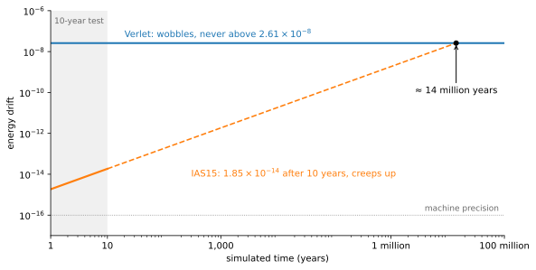

# Energy drift: how EMMA checks its own accuracy

This document explains how EMMA can tell how accurate it is without knowing the right answer, the problems that shaped how it measures that, and how I built it. In real gravity a system's total energy never changes, so EMMA adds up the energy of all its bodies and watches how far that total moves as the simulation runs. Any change is a mistake the integrator made, and the size of the change shows how big the mistakes are. That change, as a fraction of the starting energy, is the energy drift.

| Ten years of the solar system | Verlet | IAS15 |
|---|---|---|
| Worst energy drift | 2.61 × 10⁻⁸ | 1.85 × 10⁻¹⁴ |
| Angular momentum drift | 5.35 × 10⁻¹⁵ | 3.79 × 10⁻¹⁵ |

## 1. Energy drift: what it is and why we need it

### Energy, and why it stays the same

Every body has two kinds of energy.

Kinetic energy is the energy of motion. A body of mass m moving at speed v has ½ m v² of it, and the system's total is the sum over all its bodies. A heavy or fast body has a lot.

Potential energy is the energy of position. Two bodies a distance r apart have −G m₁ m₂ / r of it, and the total is the sum over every pair. It's negative, and more negative the closer the two are: think of it as how deep they sit in each other's gravity wells.

The total energy is the kinetic plus the potential. For the solar system it's negative, which means the planets are bound: they don't have enough energy to escape the Sun.

The two kinds trade back and forth all the time. At its closest point to the Sun, Mercury moves fastest, so it has the most kinetic energy, but it also sits deepest in the Sun's well, so its potential energy is at its most negative. At its farthest point it's slower but higher up. The sum never changes. That's conservation of energy, and for gravity, which has no friction, it holds exactly.

### Angular momentum

Angular momentum is how much spin the whole system has. For one body it's its mass times its position crossed with its velocity, m (r × v), and the system's is the sum over all bodies. Real gravity keeps it exactly constant too, because the pull between two bodies always points straight from one to the other.

### Drift

To check a calculation you usually need the right answer, and nobody knows exactly where every body in a simulation will be in ten years. But one thing is certain: the total energy at the end must equal the total energy at the start. If it stayed the same, the integrator did well. If it changed, the integrator made mistakes, and the size of the change shows how big they were. That's why every simulation of gravity needs a check like this: it's the one answer known in advance.

```
drift = |energy now − energy at the start| / |energy at the start|
```

### Reading numbers like 2.61 × 10⁻⁸

The drift numbers are tiny, so EMMA writes them in scientific notation. The program shows 2.61 × 10⁻⁸ as `2.61e-08`, which means: move the decimal point 8 places to the left.

| Written | Means | As a decimal |
|---|---|---|
| `2.61e-08` | 2.61 × 10⁻⁸ | 0.0000000261 |
| `1.85e-14` | 1.85 × 10⁻¹⁴ | 0.0000000000000185 |
| `1e-16` | 10⁻¹⁶ | about the smallest relative difference a double can tell apart |

The exponent matters most. Between 10⁻⁸ and 10⁻¹⁴ the exponent differs by 6, so the second number is about a million times smaller.

### Energy sets the size of an orbit

For a planet going around the Sun, its energy decides how big its orbit is. A simulation that slowly adds energy makes orbits grow, and the planets spiral outward. One that slowly removes energy makes them spiral inward. So the energy drift measures how wrong the orbits are getting.

To get a feel for the sizes: Jupiter is about 778 million km from the Sun. An error of 2.61 × 10⁻⁸ in that distance is about 20 km, and an error of 1.85 × 10⁻¹⁴ is about 1.4 cm.

### Two integrators, two kinds of error

An integrator moves the bodies forward through time in small pieces (`integrator-interface.md`). EMMA has two, and their errors behave differently.

Each Verlet piece moves a body using the force at the start of the piece, works out the force at the new position, then corrects the velocity using the average of the two. That would be exact if the acceleration changed in a straight line during the piece, but Mercury swings around the Sun on a curve, and its acceleration keeps turning. In the solar system the pieces are 0.1 day long, so Mercury's 88-day orbit takes 880 of them, and every one cuts the corner a little.

Verlet is symplectic: its corner-cutting errors don't pile up, they cancel out over each orbit. The energy wobbles a little above and below the true value but never runs away, even over millions of steps. That's why Verlet is the classic choice for long simulations. The 2.61 × 10⁻⁸ in the table is the size of that wobble at its worst moment in ten years. Its angular momentum drift, 5.35 × 10⁻¹⁵, is pure rounding: with forces that are equal, opposite and point straight from one body to the other, each of Verlet's two moves keeps angular momentum exactly.

IAS15 samples the force at 8 moments across each piece and fits a smooth curve through them, so it follows the real curve of the acceleration (`ias15.md`). It's 15th order: halving the piece length divides its error by 2¹⁵, about 33,000. With 0.1-day pieces, the mistakes of the method itself are far smaller than a double can store. All that's left is rounding: 36,500 steps, each rounding in the 16th digit, add up to about 10⁻¹⁴. IAS15 is as accurate as the computer's arithmetic allows, which is called machine precision.

IAS15 isn't symplectic, so its tiny error slowly creeps upward instead of wobbling. At the rate it grew over these ten years, it would take about 14 million simulated years to reach the size of Verlet's wobble.so what



| | Velocity Verlet | IAS15 |
|---|---|---|
| How it moves a body through a piece | Assumes the acceleration changes in a straight line between the start and the end | Fits a smooth curve through the force at 8 moments |
| Force calculations per piece | 1 | About 15 to 25 |
| How the error shrinks with shorter pieces | Half the piece length, a quarter of the error (2nd order) | Half the piece length, 1/32,768 of the error (15th order) |
| Where its error comes from | The straight-line assumption | Almost only rounding |
| How the error behaves over time | Wobbles around a fixed value (symplectic) | Tiny, and slowly creeps up |
| Speed | Fast | Each piece costs 15 to 25 times more |
| Best for | Many bodies and long runs | Few bodies, close encounters, checking results |

### The close pass

Close encounters are where integrators are tested hardest, because the forces change fast. In EMMA's test, two Earth-mass planets miss each other by about 5 Earth radii at 4 km/s.

Verlet splits its steps into up to 55 pieces and changes the energy by 1.92 × 10⁻⁵. IAS15 shrinks its own pieces, up to 32 per step, and changes it by 2.72 × 10⁻¹³, 100 million times less. IAS15 uses fewer pieces, but each costs 15 to 25 force calculations, so it does more work in total: the extra work buys accuracy, not speed.

## 2. Problems and decisions

### Checking accuracy without the right answer

Problem: there's no exact answer to compare a simulation with.

Decision: watch the two totals that real gravity keeps exactly constant, the energy and the angular momentum, and show how far they move.

### Comparing different systems

Problem: the solar system's energy and a pair of stars' energy are different sizes in different units, so a raw change in energy means nothing on its own.

Decision: measure the change as a fraction of the starting value. The units cancel, and a drift of 0.01 means "off by 1%" in any system.

### Bodies at the same point

Problem: the potential, −G m₁ m₂ / r, becomes infinite if two bodies land on the same point.

Decision: a tiny softening length, ε = 10⁻⁷ AU, about 15 km, added to every distance: −G m₁ m₂ / √(r² + ε²). It's far smaller than any body, so in practice gravity is unchanged. The force uses the same ε, so the energy and the force always agree, and the drift measures only the integrator's mistakes.

### Relativity's extra pull

Problem: with general relativity on, the bodies feel an extra pull (`relativity.md`), and plain Newtonian energy would no longer be conserved.

Decision: the energy includes the extra pull's own potential, so the total stays conserved with relativity on.

### How often to measure

Problem: the potential energy sums over every pair of bodies, which is too slow to do every frame with many bodies.

Decision: measure four times a second, and keep the last 30 seconds for a graph.

### Changes that are real

Problem: adding a body brings its own energy, a merge turns some energy into the crash, and switching integrators or changing relativity changes how the energy is measured. None of those are the integrator's mistakes.

Decision: start from a new baseline whenever bodies are added, merged or loaded, and whenever the integrator, General relativity or Exaggerate changes.

### Reading it at a glance

Problem: numbers like `+1.2e-09` are hard to judge quickly.

Decision: color them. Green below 10⁻⁶, plain up to 10⁻³, and orange above that.

## 3. How I built it

### The energy

`Simulation::totalEnergy()` adds the two parts:

```cpp
return world.kineticEnergy() + gravity.potentialEnergy(world.bodies);
```

`World::kineticEnergy()` sums ½ m v²:

```cpp
double kinetic = 0.0;
for (const Body& b : bodies) kinetic += 0.5 * b.mass * b.velocity.lengthSquared();
return kinetic;
```

`Gravity::potentialEnergy()` sums over every pair, with the softening and the relativity term:

```cpp
const double r2 = (bodies[j].position - bodies[i].position).lengthSquared() + eps2;
const double mi = bodies[i].mass, mj = bodies[j].mass;
potential -= units::G * mi * mj / std::sqrt(r2);
if (gr != 0.0 && (everyPair || marks[i] || marks[j])) potential -= gr * mi * mj * (mi + mj) / r2;
```

`World::angularMomentum()` sums m (r × v) about the origin:

```cpp
Vector3D l;
for (const Body& b : bodies) l += b.position.cross(b.velocity) * b.mass;
return l;
```

`lengthSquared()` is the dot product of a vector with itself, |v|², which saves a square root where the length itself isn't needed.

### The readout

`main.cpp` checks the totals four times a second:

```cpp
energyTimer += frameDt;
if (energyTimer >= ENERGY_REFRESH) {
    energyTimer = 0.f;
    const double energy = sim.totalEnergy();
    const Vector3D momentum = sim.angularMomentum();
    if (sim.changeCount() != baselineChange) {  // bodies changed: start a new baseline
        baselineChange = sim.changeCount();
        baseEnergy = energy;
        baseMomentum = momentum;
        driftHistory.clear();
    }
    energyDrift = baseEnergy != 0.0 ? (energy - baseEnergy) / std::abs(baseEnergy) : 0.0;
    ...
}
```

`changeCount()` goes up whenever bodies are added, merged, loaded or cleared, so comparing it with the count at the last baseline tells `main.cpp` when to start again. Switching integrators or changing relativity sets `baselineChange` to a value the count can never have, `~0ull`, which forces a new baseline the same way. `~0ull` is zero with every bit flipped: the largest number an `unsigned long long` can hold.

The Physics tab shows both drifts with a sign, colored by `driftColor`:

```cpp
ImVec4 driftColor(double drift) {
    const double a = std::abs(drift);
    if (a < 1e-6) return GOOD;
    if (a < 1e-3) return ImGui::GetStyleColorVec4(ImGuiCol_Text);
    return WARN;
}
```

### Tests

1. `conservation`: ten years of the solar system with Verlet. The energy, checked every 100 steps, never drifts by more than 10⁻⁶, the angular momentum by no more than 10⁻⁹, no step needs splitting, and no bodies merge.
2. `ias15_conservation`: the same ten years with IAS15. Both drifts stay below 10⁻¹⁰.
3. `close_pass`: the two planets of the close pass with Verlet. The pair's orbital energy changes by less than 1%, and the steps do split.
4. `ias15_close_pass`: the same pass with IAS15, to within 10⁻⁷.

Each prints its numbers, so you can see the real values next to the limits.

## Things to try

1. Load the solar system and speed time up. In real time the steps are so small that both integrators look perfect.
2. Open the Physics tab and watch the energy drift with Verlet: a small wobble on the graph.
3. Switch to IAS15. The readout starts from a new baseline and sits near zero.
4. Set up a close pass of two planets with each integrator and compare.

## Glossary

| Term | Meaning |
|---|---|
| Kinetic energy | The energy of motion, ½ m v² |
| Potential energy | The energy of position in gravity, −G m₁ m₂ / r for a pair |
| Bound | Not enough energy to escape: total energy below zero |
| Angular momentum | How much spin a system has, the sum of m (r × v) |
| Drift | How far a total that should stay constant has moved, as a fraction |
| Integrator | The method that moves bodies forward in time |
| Symplectic | An integrator whose energy error wobbles around a fixed value instead of growing |
| Order | How fast an integrator's error shrinks with shorter pieces: 2nd order means half the length, a quarter of the error |
| Machine precision | The limit set by rounding: a double keeps about 16 digits |
| Softening | A tiny length, ε, added to distances so the force never becomes infinite |
| Baseline | The values the drift is measured from |
